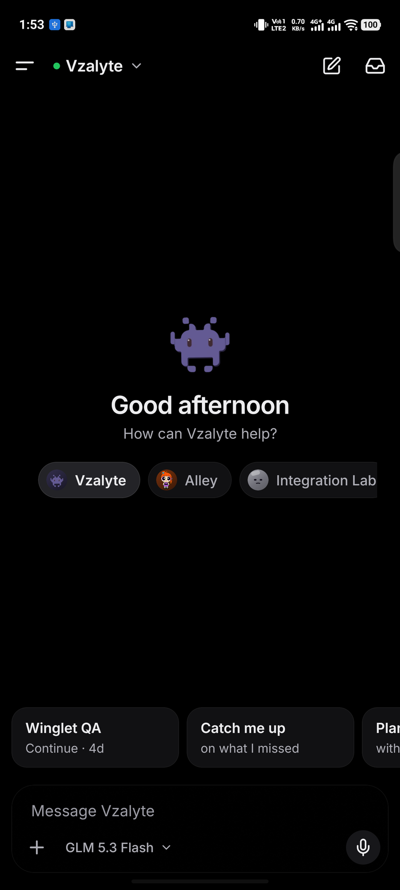
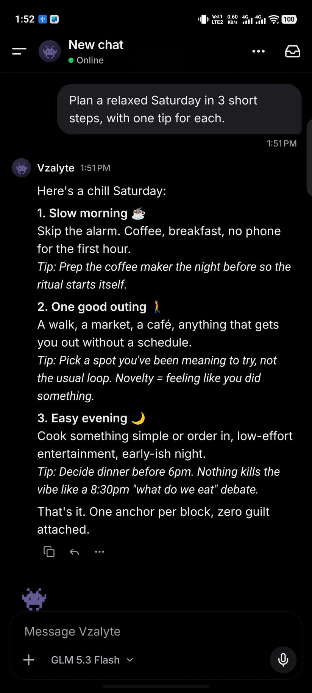
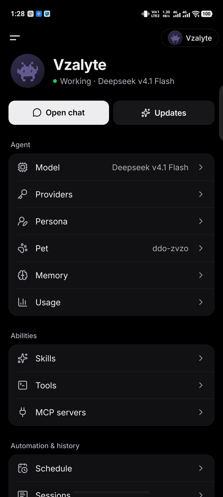
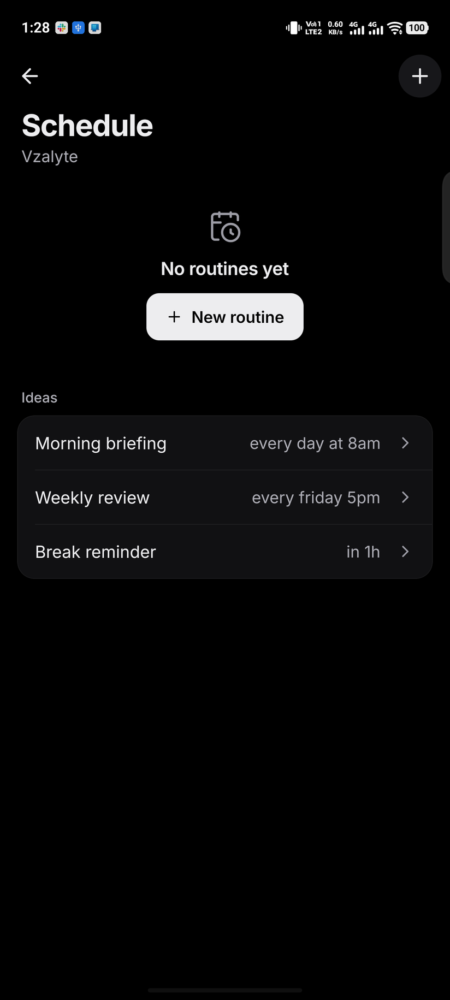
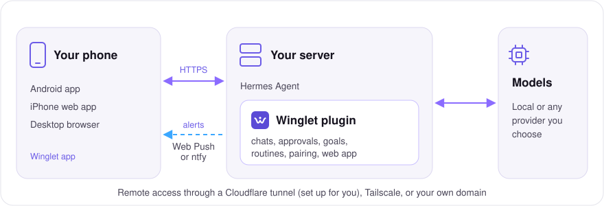

<div align="center">


# Winglet

**The open-source Dots for Hermes Agent. Your agents, in your pocket.**

Named AI agents that live on *your* server, work while you're away,
and tap you on the shoulder when they need you.

[](LICENSE)
[](https://github.com/VIKASRP24/winglet/releases/latest)
[](https://github.com/VIKASRP24/winglet/actions/workflows/ci.yml)


<br/>

&nbsp;
&nbsp;
&nbsp;


**[Get started](#get-started)** · **[Features](#what-it-does)** · **[How it works](#how-it-works)** · **[FAQ](#faq)**

</div>

> [!TIP]
> **New in [v0.4.0](docs/releases/v0.4.0.md):** a Home built around your main bot, pets throughout the app,
> one "Add a bot" flow, and quieter chats with tool activity you can expand.

## 💡 Why Winglet?

OpenAI Dots, Meta Muse and Grok Bot showed what a personal agent on your phone should feel like.
Winglet brings that to [Hermes Agent](https://github.com/NousResearch/hermes-agent), the open-source
agent by Nous Research.

<table>
  <tr>
    <td width="33%" valign="top">
      <h4>🏠 Your server, your models</h4>
      Hermes runs on your own machine with any model provider, local models included.
    </td>
    <td width="33%" valign="top">
      <h4>📲 No app store needed</h4>
      An APK for Android, and an installable web app with notifications for iPhone and desktop.
    </td>
    <td width="33%" valign="top">
      <h4>🐾 Not another chat window</h4>
      Each bot has a name and an animated pet, and Home shows what it's doing and what it needs from you.
    </td>
  </tr>
</table>

<a id="get-started"></a>

## 🚀 Get started

**1. On your Hermes machine**, with the Hermes messaging gateway installed:

```bash
hermes plugins install VIKASRP24/winglet/plugin
hermes plugins enable winglet
hermes winglet setup          # sets up HTTPS, starts the gateway, shows a QR code
```

Setup gives you a free HTTPS address through Cloudflare. You don't need an account, a domain or any open ports.

**2. On your phone**, scan the QR code:

| 🤖 Android | 🍎 iPhone | 💻 Desktop |
|---|---|---|
| Install `winglet-<version>-arm64-v8a.apk` from the [latest release](https://github.com/VIKASRP24/winglet/releases/latest), then scan the QR in the app. | Scan with the Camera app, then **Share → Add to Home Screen**, open Winglet from your Home Screen and enter the pairing code. | Open the link from `hermes winglet pair` in any browser. |

That's it. For Tailscale or your own domain, notifications, live typing and updates, see the **[setup guide](docs/SETUP.md)**.

<a id="what-it-does"></a>

## 🧭 What it does

<table>
  <tr>
    <td width="50%" valign="top">
      <h4>💬 Chats</h4>
      A chat for every topic, with streaming replies, code, photos, files and voice notes. Search every chat, share from any Android app, and keep working on a bad connection.
    </td>
    <td width="50%" valign="top">
      <h4>✅ Approvals and questions</h4>
      Approve risky commands and answer questions with one tap, from the app or the notification. The Inbox collects everything waiting on you.
    </td>
  </tr>
  <tr>
    <td valign="top">
      <h4>🎯 Goals</h4>
      Give a chat an outcome and Hermes keeps working on it, turn after turn, until it's done. Follow progress in the chat and on Home.
    </td>
    <td valign="top">
      <h4>⏰ Routines</h4>
      Schedule work in plain words, like "weekdays at 9am" or "every 2h". Results land in the Updates chat.
    </td>
  </tr>
  <tr>
    <td valign="top">
      <h4>🐾 Pets and many bots</h4>
      Give each bot an animated face from <a href="https://petdex.dev">petdex</a>. Pick a main bot, add more for separate jobs, and let them ask each other. <a href="docs/BOTS.md">More on bots →</a>
    </td>
    <td valign="top">
      <h4>🧠 Your agent</h4>
      Switch model and reasoning level per chat. Edit persona and memory, track usage, and manage skills, tools and MCP servers.
    </td>
  </tr>
  <tr>
    <td valign="top">
      <h4>🖥️ Your server</h4>
      Processor, memory and disk at a glance. Pause, restart and update Hermes and Winglet, read logs, and browse past sessions.
    </td>
    <td valign="top">
      <h4>🔒 Safe by default</h4>
      Verified QR pairing, signed owner actions, an activity log, members who can't see your chats, and an optional app lock.
    </td>
  </tr>
</table>

See **[all features](docs/FEATURES.md)** for the full list.

## 📸 Tour

<table>
  <tr>
    <td align="center"><br/><sub>What it's working on</sub></td>
    <td align="center"><br/><sub>Code, highlighted</sub></td>
    <td align="center"><br/><sub>A model per chat</sub></td>
    <td align="center"><br/><sub>Your agent</sub></td>
  </tr>
  <tr>
    <td align="center"><br/><sub>Routines</sub></td>
    <td align="center"><br/><sub>Results in Updates</sub></td>
    <td align="center"><br/><sub>Search every chat</sub></td>
    <td align="center"><br/><sub>Light mode</sub></td>
  </tr>
</table>


<sub>Screenshots show the interface before v0.4, which redesigned Home, avatars and model controls.</sub>

<a id="how-it-works"></a>

## ⚙️ How it works



- **The app** (`app/`) is one [Expo](https://expo.dev) / React Native codebase that builds the Android APK and the iPhone/desktop web app.
- **The plugin** (`plugin/`) adds Winglet to Hermes as a messaging platform, the same way Telegram or Slack plug in. Each chat is a Hermes session, and approvals, questions, goals and routines use Hermes's own mechanisms. **No fork of Hermes.**

<a id="faq"></a>

## ❓ FAQ

<details>
<summary><b>Do I need to pay for anything?</b></summary>

No. Winglet is MIT-licensed and needs no App Store or Play Store account. You need a machine that runs
Hermes Agent and whatever model provider you choose (local models work).
</details>

<details>
<summary><b>Does my server need to be public on the internet?</b></summary>

No. Setup uses an outbound Cloudflare tunnel, or you can use a private network such as Tailscale or your own
HTTPS proxy. See the [remote access guide](docs/REMOTE_ACCESS.md).
</details>

<details>
<summary><b>Is it safe?</b></summary>

Only paired devices can talk to your agent. Pairing codes are single-use and expire after 10 minutes, and each
phone gets its own revocable token (`hermes winglet devices` / `unpair`). The QR carries your server key's
fingerprint, so the phone checks it's really your server. Owner actions are signed by a key that never leaves
the phone, so a token copied from a log can chat but can't change anything. Every such action is listed in
Agent → Devices → Activity, and risky commands still need your approval. Prefer Tailscale or another private
network over opening a port to the internet.
</details>

<details>
<summary><b>Can someone else use my agent?</b></summary>

Yes, as a member: Agent → Devices → Add a device → Member (or `hermes winglet pair --member`). Members have
their own chats and can't see yours, approve commands or change settings. They share the agent's memory and,
unless you limit them in Agent → Tools, its tools, so only add people you trust with it.
</details>

<details>
<summary><b>What can I control from my phone?</b></summary>

Owners get Agent → Server: the machine's processor, memory and disk, **Pause new work** (Hermes's `/pause`:
new chats, routines and background tasks wait, anything already running finishes), **Restart**, and updates
for Hermes and Winglet with progress that carries on across the restart. **Logs** shows Hermes's agent,
gateway and error logs with keys and tokens hidden, and **Schedule** takes routines in plain words
("weekdays at 9am", "every 2h", "in 30m") and posts their results to the Updates chat.

In-app updates need Hermes installed from git and Winglet installed with `hermes plugins install`; otherwise
the app shows the command to run on the server. Under Agent → Abilities you manage **Skills**, **Tools**
(including approvals and what members can use) and **MCP servers**. Changes to tools apply from the next
message; MCP changes apply when you tap Reconnect.
</details>

<details>
<summary><b>Why a web app on iPhone?</b></summary>

It lets you use Winglet without a native iOS build or an App Store account. It supports notifications on
iOS 16.4+ when added to the Home Screen over HTTPS.
</details>

## 🗺️ What's next

- [ ] Live screen: watch the agent's computer and take over when it needs you
- [ ] Real-time voice
- [ ] Widgets and backups

The full plan is in [docs/APP_PLAN.md](docs/APP_PLAN.md).

## 🛠️ Development

```bash
# Plugin tests
pip install "aiohttp>=3.9,<4" cryptography "httpx>=0.27,<1" qrcode http_ece pyyaml packaging pytest pytest-aiohttp
pytest

# App (Expo)
cd app && npm ci
npx expo start            # press "w" for web, or scan with a development build
npx tsc --noEmit && npm test

# Rebuild the web app bundled into the plugin
./scripts/build-web.sh
```

To try the plugin against your own Hermes, copy `plugin/` to `~/.hermes/plugins/winglet/` and enable it.

## 🤝 Contributing

Early days, so everything is open: code, design, naming, ideas. See [CONTRIBUTING.md](CONTRIBUTING.md).
Found a security issue? Please read [SECURITY.md](SECURITY.md) first.

---

<sub>Winglet is an independent community project, **not affiliated with or endorsed by Nous Research, OpenAI,
Meta or xAI**. "Hermes Agent" is a project of Nous Research; other product names only describe what Winglet
is similar to. Licensed under [MIT](LICENSE).</sub>
