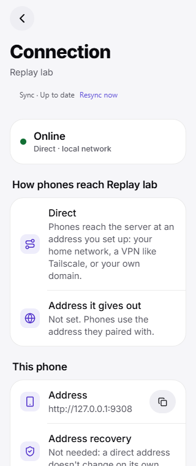
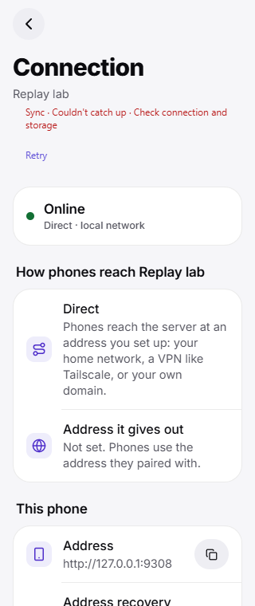
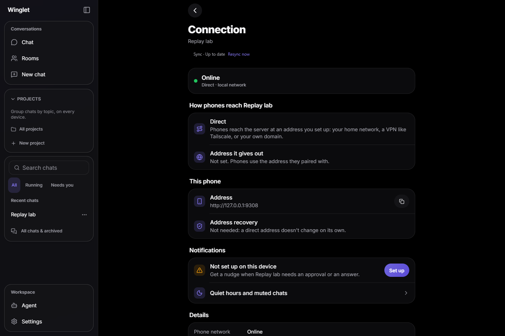

# Resumable events and reconnect recovery

For Codex orchestrator review. Code implemented; native build not run; **MOBILE VALIDATION PENDING**.
Draft PR: https://github.com/VIKASRP24/winglet/pull/51. Branch: `codex/major-08-event-replay`.
Reviewed integration parent: `87cf6269c42ea4610880ef158110e48837e34848` (features 01–06).
Implementation/review followed the Agency Agents SRE architecture → implementation → review workflow,
without subagents. The earlier server-only handoff is superseded by this document.

## What the user gets

The actual WebSocket connection now resumes missed messages, edits, deletions, Inbox changes and
additive namespaced feature notifications. If replay cannot prove its position, the app fetches
the authenticated snapshot and cached chat histories, then resumes again from the snapshot watermark.
Cached reading and composing remain available. Replay applies existing state handlers; it never
invokes a send, task control, approval operation or offline queue entry.

Chat headers show quiet catching-up feedback and a temporary completion message. Connection shows
Sync and Resync now. A failed snapshot or durable cache write leaves a Retry action. Unsupported
servers keep the original synchronous reconnect path and show no replay UI.

## Final additive wire contract

No protocol/minimum-version bump. Capability: `features.event_replay: true`.

```json
{"type":"hello","event_stream":{"epoch":"generation","scope":"authenticated-scope","watermark":12,"keep_events":1500,"keep_seconds":259200}}
{"type":"resume","epoch":"generation","scope":"authenticated-scope","cursor":8}
{"type":"resume","ok":true,"epoch":"generation","scope":"authenticated-scope","watermark":12,"cursor":12,"events":[],"has_more":false}
{"type":"resume","ok":false,"reason":"gap","epoch":"generation","watermark":12}
```

Live/replayed durable events carry **`event_seq`**. Existing feature-local fields remain intact:
`task.event.seq` is still the execution sequence, and room-local epochs are unchanged. Clients never
interpret a bare feature `seq` as a replay cursor. Other features need only use the existing awaited
`Hub.broadcast` path; the envelope is added centrally. Presence, pet updates, bot lists, restart job
progress and pong are excluded. Per-device `project.sync` stays outside the shared journal; hello
and recovery snapshots provide the current authenticated project structure.

`GET /api/sync/snapshot` uses bearer/device authorization and existing bot routing. It returns
`server_id`, bot profile name (or null), `scope`, `epoch`, `watermark`, visible chats, Inbox, pending
count, sanitized pause state, current device identity, project snapshot and durable message tombstones.

### Scope, ordering and subscription race

The server derives scope from persistent server ID, bot profile, authenticated device ID and current
role. A cursor from another bot/device/role is refused. The epoch persists across ordinary restarts;
an explicit journal reset rotates it. A restored/behind head, corrupt cursor, missing retained prefix,
internal journal hole or corrupt payload produces an explicit snapshot refusal.

The socket is registered and hello is sent under the publisher lock, preventing a live event from
overtaking hello. The head is read before the corresponding snapshot. Publisher scope is derived
from the event's actual chat/bot, including adapter calls made outside ambient bot context.
After recovery/history fetch, the client requests replay from that earlier watermark; it does not
assume an HTTP snapshot plus buffered live frames proves subscription coverage. Live frames arriving
during catch-up are held and released after ordered replay. Sequence gaps in a filtered device's
reply are normal: page cursors advance through scanned invisible rows.

### Application, persistence and acknowledgement

The production Connection owns a SyncSession. Application and persistence run in one serialized
queue. Replay uses existing message identity and client-delivery identity, drops duplicate
`event_seq` values, and suppresses replay notification sounds/toasts. Next-page requests happen only
after the applied state is durably checkpointed. A cursor is never saved separately or on a timer.

`replay:<local-server-id>` is one encrypted native cache value / one committed IndexedDB transaction
containing the cursor and covered chats, messages, tombstones, loaded flags, Inbox, projects, tasks,
pause state and device identity. Strict writes reject on keychain, disk or transaction failure;
normal best-effort cache behavior is unchanged. Snapshot fetches resolve the current verified server
address and credentials, including address recovery, rather than capturing the original socket URL. On startup the checkpoint restores those state slices
before resuming. Persisted acknowledged messages filter stale outbox entries by `meta.client_id`.
Legacy cursor-only records are intentionally ignored and repaired by snapshot.

Snapshot merge does not replace drafts, draft attachments, reply context or the outbox. Cached chat
histories are reconciled before the snapshot cursor is committed; all scoped tombstones are included.
Normal explicit/remote chat-deletion handling retains existing chat-removal semantics.

### Authorization and retained content

Every resume refreshes the authenticated token, including token rotation and revocation. Current
role and current chat ownership filter retained rows. Unknown unscoped namespaced events are
owner-only; scoped chat events use the existing ACL. Checkpoint/system details retain their owner
restrictions. Member pause notes and pending counts are shaped per authenticated device.

Message, chat and Inbox journal entries contain record references rather than another content copy.
Replay resolves those references from current authoritative rows, so edited/deleted text and answered
cards cannot be resurrected. Deleted messages become tombstones. Chat previews are repaired inside
the message-deletion transaction and broadcast as an authoritative chat update. Existing retained
payload rows from the earlier implementation are also resolved against current records on replay.
Feature publishers remain responsible for sanitizing their own namespaced payloads before broadcast.

### Bounds and honest guarantees

Newest 1500 events / three days per bot, whichever expires first. Individual journal payloads above
64 KiB become `sync.hint`. Replies scan at most 200 rows and carry at most approximately 512 KiB of
event payload, including after authoritative references expand. Replayed hints trigger the complete
scoped recovery path. Metadata adds a small fixed envelope beyond that payload bound.

The client bounds queued/held work to 512 frames and approximately 4 MiB, disconnects a slow consumer,
and keeps the last durable cursor. Replay waits time out after 15 seconds. Server publication waits
at most two seconds per socket send, removes a slow socket and requests reconnect/resync (1013).

Delivery is **at least once**, never exactly once. `Hub.publish(write, event_of)` commits authoritative
SQLite mutations and journal rows together; journal failure rolls the mutation back. Generic
`broadcast` journals already-committed feature notifications and cannot make external Hermes work
or another feature's earlier write atomic. A process can crash in that external mutation/notification
window. Runtime task/process history remains governed by those features' authoritative snapshots.
Unpersisted upstream deltas and retention-expired events are not reconstructable as an exact timeline.
The transcript/history endpoints remain authoritative. Large durable checkpoints can add storage
work during heavy streaming; bounded queues favor reconnect recovery over unbounded memory growth.

## Storage and shared files

Feature-local SQLite tables created idempotently: `event_streams(bot,next_seq,created_at)` and
`event_log(bot,seq,kind,chat_id,created_at,payload)` with indexed unique bot/sequence identity.
`kv.event_epoch` stores generation. Dropping these tables and rotating epoch removes replay data
without changing transcripts/devices; stale clients recover by snapshot. No numeric global
migration version, Hermes pin, release version or generated `plugin/web` asset changed.

Shared wiring: `plugin/hub.py`, `plugin/store.py`, `app/src/lib/store.ts`, cache native/web adapters,
`types.ts`, ChatView and Connection. Feature decisions live in `plugin/event_replay.py` and
`app/src/features/event-replay/`. The integration merge preserves branching revision metadata,
structured execution, projects, rooms and process behavior.

## Reference comparison and provenance

Read-only Herald source snapshot `95ca999fa48c1c9de232fe499a174900f0d25272` and its MIT license
were inspected, including EventReplay.kt and EventReplayTest.kt. Related transcript/history/RPC
connection code informed the original implementation. Notice and full MIT license are retained in
`third_party/notices/herald-event-replay.md`. No Kotlin is copied verbatim.

| Reference behavior | Winglet implementation | Intentional difference/evidence |
| --- | --- | --- |
| Sequence/epoch validation and duplicate removal | Validated event_seq, scope and epoch; ordered application | Preserves task-local seq; filtered gaps are valid |
| Refuse truncation, wrong runtime and holes | Explicit cursor/gap/epoch/journal refusal | Durable SQLite instead of per-runtime ring |
| Refetch transcript when replay cannot prove continuity | Scoped snapshot, cached histories, then replay from watermark | Preserves composer state and repairs Inbox/projects too |
| Reconnecting/waiting feedback | Non-blocking sync status and Retry | Existing Winglet themes, pets and navigation remain |

## Validation and evidence

- Final client suite: **338 passed** (`node --test tests/*.test.ts`); real store/socket harness included.
- TypeScript typecheck: passed.
- Web production export and Android Hermes-bytecode export: passed in private output directories.
  Those exports preceded the final oversized-hint/reference review guards; current PR CI runs web
  typecheck/export again. Android export is bundling evidence, not a native build.
- Replay/bot regression run: **48 passed** before additional privacy/bounds tests.
- Final replay server suite plus private project socket regression: **44 passed** (43 replay tests).
- Full pinned-Hermes local run: **500 passed, 1 skipped, 1 failed** in 328.74 seconds. The only
  failure was the previous exact one-encode broadcast assertion. Scope lookup reuse now retains one
  chat lookup; the updated regression proves fixed journal overhead stays constant with three and
  twenty-three owner sockets. That exact CI regression subsequently **passed**. The targeted mixed
  run before this assertion update had 64 passes and that same assertion failure.
- Final client address-recovery/storage/replay regression run: **66 passed** after the full 338-test
  run. This adds a recovery case proving snapshot fetch follows the verified current server address.
- Initial PR CI at `e22879e`: app typecheck/web export passed; three plugin jobs failed on the same
  efficiency assertion. Final pushed head reruns CI; the Codex orchestrator owns that watch.
- `git diff --check`: passed before publication.
- No phone, emulator, ADB, RDP, provider or live Hermes interaction was used.

Disposable Playwright browser evidence uses `scripts/event_replay_fixture.py`, production web output,
and synthetic local data only. Checked 320 px light Connection view: document width equals viewport
width (320), Resync target height 44 px. Injected HTTP 503 on the snapshot route produced actionable
Retry while the rest of the screen stayed readable; removing the fault and Retry recovered.
Wide dark/reduced-motion evidence is included. The injected HTTP 503 creates one expected browser
network console error; normal fixture load had no JavaScript errors.





## MOBILE VALIDATION PENDING

Use PR 51's reviewed final integration merge/build, not a stale feature-only APK. The orchestrator
owns signed native builds and all emulator/physical testing. Suggested Android API 35+ emulator,
320/390 dp phone, tablet and larger font settings; physical Android for process death, backgrounding,
keychain/storage recovery and genuine network handoffs. iPhone behavior is unvalidated.

1. Export this branch's web app into `app/dist-replay-web`; run
   `python scripts/event_replay_fixture.py` from the repository root with aiohttp installed.
   It binds only 127.0.0.1:9308, prints a disposable pairing code, uses a temporary database and
   never connects to Hermes or push providers. The orchestrator can forward that test port for
   its later emulator/device checks. Fixture-only authenticated routes `/fixture/message` and
   `/fixture/epoch` generate synthetic arrivals and rotate epoch.
2. Pair two test clients. Disconnect/force-stop one; add messages, edits, Inbox outcomes and deletions
   on the other. Reopen: no duplicate, stale deleted preview or repeated chime; cursor covers
   persisted applied state. Acknowledged client_id must not re-enter the send queue.
3. Disconnect before hello, during replay, while committing a page and during snapshot/history fetch.
   Relaunch and verify ordered recovery without losing draft text, attachments or reply context.
4. Rotate the fixture epoch, trim retention and inject a malformed/stale cursor. Verify snapshot,
   history reconciliation, second resume, eventual quiet idle and readable cached chats throughout.
5. Revoke/rotate token or change role while offline. Old auth cannot replay; old role/device/bot
   cursor is refused; member replies contain only current accessible chats and sanitized state.
6. Throttle network/storage, background during streaming and fill storage. Verify bounded recovery
   or Retry; no persisted cursor ahead of state, no automatic control execution, no full-screen
   loading barrier. Check narrow, tablet, dark/light, large fonts and reduced motion natively.

## Review priorities

1. Current ACL and record-reference replay in `_resume`; explicit `scope` and `event_seq` compatibility.
2. Actual socket queue/checkpoint/hydration ordering; safe acknowledgement and recovery histories.
3. Publisher bot derivation, subscription lock, private project broadcaster and slow-consumer bounds.
4. Honest non-atomic external-feature/upstream limits and final combined native validation.
