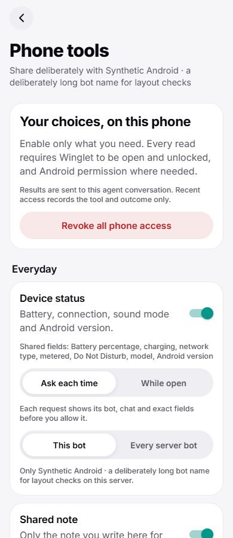
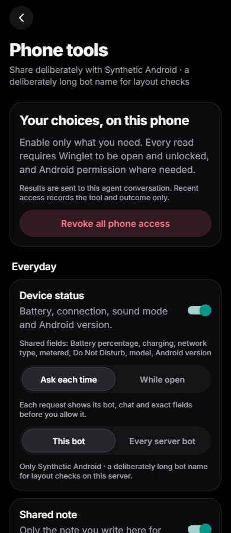
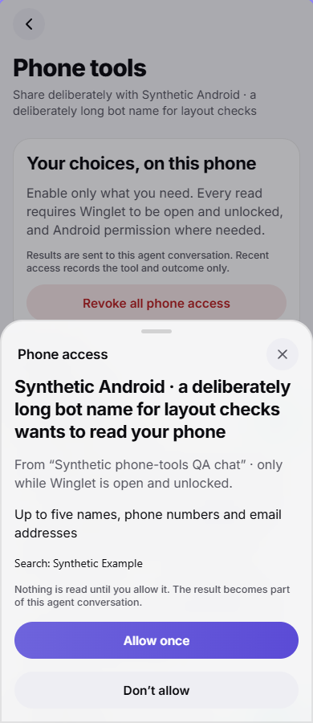

# Phone tools — Assignment 11

Status: **CODE IMPLEMENTED; draft for Codex orchestrator review. MOBILE VALIDATION PENDING.**

Branch: `codex/major-11-phone-tools`. The stopped schema/design was preserved unchanged in `bbc7490`;
the approved integration baseline `87cf6269c42ea4610880ef158110e48837e34848` was merged in `acfae14`.
The earlier document was a plan; this replacement records the actual implementation.

Primary role: Security Engineer, following the Agency Agents architecture → implementation → distinct review workflow.
No subagents, real phone, ADB, emulator, remote Hermes, contacts, calendar or location data were used.

## Implemented subset

All tools are off until a verified paired Android device signs an explicit per-tool grant.

| Hermes tool | Returned fields and limits |
| --- | --- |
| `phone_status` | Battery percentage/charging, network type/metered, Do Not Disturb, model and Android version. No device/network identifiers. |
| `phone_shared_note` | Only the note typed into Winglet, at most 2000 characters. Memory-only for this app session, separately keyed by bot. |
| `phone_location` | Latitude, longitude and accuracy. Approximate results round to 0.01 degrees and report at least 1500 m accuracy; precise always requires a request decision and Android fine permission. A current fix times out after 10 s. |
| `phone_contacts` | Specific name/number/email query of 2–80 characters; at most 5 contacts, 3 numbers and 3 emails each. Names ≤200 characters; numbers/emails ≤254. Native candidate scan ≤100 data rows. No IDs, notes, photos, addresses or birthdays returned. |
| `phone_calendar` | UTC millisecond range of at most 31 days, at most 50 overlapping instances. Title ≤300 characters, calendar name ≤200, start/end and all-day only. No attendees, descriptions, locations or reminders. |

No arbitrary command tool, fan-out, background location, SMS, accessibility, device-admin, Health Connect,
geofence, screen-time, alarms, clipboard or write operations are registered or advertised.

The Kotlin Expo local module lives in `app/modules/winglet-phone-tools/`; Expo autolinking resolves
`expo.modules.wingletphonetools.WingletPhoneToolsModule`. `app/plugins/withPhoneTools.js` declares only
coarse/fine foreground location, contacts, calendar and network-state permissions. Generated `app/android/`
is ignored and is not the source of the feature. iOS/web and Android builds without the module show an
explicit unsupported state and never handshake or execute.

## Trust and request contract

`phone_tools` is an additive capability, true only when the adapter installs the registered tool bridge.
Hermes toolset: `phone_tools`. Registration uses the actual pinned `PluginContext.register_tool` contract,
with `tools.registry.no_cache_check_fn`: grant discovery must not be cached across device sessions.
No provider/model or protocol-version change is needed.

The Hermes adapter reads `HERMES_SESSION_PLATFORM`, `USER_ID`, `CHAT_ID`, and `PROFILE` via the real
`gateway.session_context` API. Only `winglet:<paired device id>` in a Winglet chat may call. Device, bot,
chat ownership, current role and grant are derived from authenticated server records, never tool arguments.
The originating phone is the only target. Of its foreground/unlocked sockets for this bot, exactly one is
chosen; requests are never broadcast or queued for offline delivery. The event journal explicitly
rejects both phone namespaces, and the generic broadcast path drops them even if misrouted by a future caller.

| Event | Meaning |
| --- | --- |
| app → `phone_tools.hello` | `{instance_id, unlocked}` after the existing authenticated hello; same lifecycle shares its instance across bot sockets. Restart, visibility or app-lock transitions rotate it and cancel prior pending access. |
| server → `phone_tool.request` | Random 128-bit ID + 192-bit nonce and current lifecycle instance, allowlisted tool/arguments, mode, ask flag, server request/expiry timestamps, authenticated bot and chat context. |
| app → `phone_tool.decision` | `{id, nonce, allow}`. Ask mode shows the request sheet. While-open mode still performs this authorization step. Precise location always asks. |
| server → `phone_tool.execute` | `{id, nonce}` only after rechecking role, device/chat/bot scope, grant, mode, foreground, unlock and expiry. This frame is required before any native read. |
| app → `phone_tool.answer` | `{id, nonce, ok, result/error}`. Exactly one execution/result settles the request. Server rechecks authority and sanitizes every returned field; unknown error text is discarded. |
| server → `phone_tool.cancel` | `{id, reason}`; dismisses decisions and cancels native work. |
| server → `phone_tool.grants_changed` | Clears local pending requests immediately. Settings can be pulled to refresh. |

Ask-mode deadline: 120 s. While-open deadline: 20 s. At most 4 concurrent requests per device;
native operations have a 15 s deadline. Server protocol timestamps/audit use epoch seconds, native/calendar
APIs use milliseconds. Client timers measure the advertised interval locally; the gateway is authoritative
for expiry. Old, duplicate, wrong-socket, wrong-device and wrong-bot decisions/answers cannot settle a request.
The client rejects transport-buffered requests from before background/resume or app-lock transitions,
and the gateway rechecks the request's lifecycle instance before execution/answer. On startup, the app
advertises locked until persisted app-lock preferences have been applied (`phoneSecurityReady`).

The app fetches authoritative grants before deciding, immediately before reading and after reading.
The native module independently rechecks OS permissions, activity foreground, device lock and expiry before
and after reads. App lock, background, explicit connection closure, disconnect, revoke, new app instance,
unpair and role changes cancel pending access. Android provider queries receive cancellation signals;
location cancellation removes its listener or cancels the platform signal. A late result is discarded.
The real pinned Hermes interrupt mechanism and parent-agent interrupt state cancel the waiting future on Stop.

Pending requests/results live only in memory. The plugin stores metadata audit rows, not arguments/results.
No sensitive payload is logged by this feature or placed in a new plaintext cache. Results deliberately enter
the requesting Hermes conversation/model context and may be retained by Hermes's existing transcript behavior;
the decision and settings screens say results are shared with that conversation.

## Routes, scope and storage

| Route | ROUTE_POLICY | Behavior |
| --- | --- | --- |
| `GET /api/phone-tools` | device | Catalog, this device's own grants, current bot scope, owner scope availability and recent metadata. |
| `PUT /api/phone-tools` | signed | Set one allowlisted tool's enabled state, `ask`/`while_open`, `bot`/`server` scope. |
| `DELETE /api/phone-tools` | signed | One-step revoke-all for this device, including cancellation. No offline outbox. |
| `GET /api/phone-tools/log` | device | Last 20 metadata entries for this device/current bot. |

A member can grant their own Android phone only in the current bot scope. Server-wide scope is owner-only.
As in the preserved schema, there is **one active scope per device/tool**, `PRIMARY KEY(device_id,tool)`;
changing bot scope replaces the previous scope and cancels its pending access. Scope `''` means the main bot,
a profile name means that bot, `'*'` means all this server's bots. The body never chooses a device or bot ID.

Additive idempotent `phone_tool_grants` and `phone_tool_events` tables from the preserved schema are used.
No global migration number. `Store.prune()` and audit insertion retain ≤30 days/5000 event rows.
Audit fields: timestamp, device, bot, chat, tool and enum outcome; detail stays `{}`. Rollback after stopping
the gateway: `DROP TABLE phone_tool_events; DROP TABLE phone_tool_grants;`. Only feature grants/history are lost.

Minimal shared wiring: `hub.py`, `store.py`, `adapter.py`, `plugin.yaml`, app `store.ts`, `_layout.tsx`,
`settings.tsx`, `app.config.js`. The feature code and tests otherwise stay in their own modules.

## UI and evidence

Settings → Agent → Phone tools appears only when the server advertises the capability. The screen has an
off-by-default explanation, one-step revoke-all, Everyday and Personal information groups, per-tool switches,
Ask each time/While open, owner-only bot/server scope, exact shared fields, permission repair, session-only
shared note, and recent metadata history. No master enable switch is needed: each capability is independent.
Loading, retry/error, offline, unavailable-server and unsupported-platform states are implemented.
The request sheet names the bot and chat, exact fields and query/date range; Allow once and Don't allow are
explicit. Dismissal denies. Expired/cancelled requests are removed. Winglet's theme/Sheet/Screen/ui tokens,
reduced-motion behavior, navigation and pets are preserved.

Playwright CLI rendered the **actual components** with a disposable resolver/native mock and local synthetic
API on ports 8311/9311. The resolver was removed after exporting ignored fixture output; it is not committed.
Production web was also exported separately and its genuine unsupported state was checked. No personal data.
320/390/820/1440 widths, light/dark and reduced motion: no document overflow. Long bot names, permission repair
and request-sheet layouts were inspected. Browser console: 0 errors/0 warnings in the inspected fixture flow.
These screenshots establish UI layout only; they do not establish Android permission/lifecycle behavior.





Larger native system font, hardware keyboard/IME/safe-area and physical lifecycle behavior remain in the
mobile recipe. Responsive settings and request layouts wrap long names and retain separate switches/buttons.

## Reference comparison and licensing

Reference: Herald `95ca999fa48c1c9de232fe499a174900f0d25272`.

| Reference behavior/source | Winglet implementation | Edge-case evidence | Difference |
| --- | --- | --- | --- |
| `PhoneTool.kt` named catalog and off-by-default toggles | Five explicit tools, exact fields, scoped signed grants | Unknown commands rejected, independent sensitive revoke tests | Restricted read-only subset; no unsupported integrations shown. |
| `PhoneToolsBridge.kt` request identity, bounded running/answered state and cancellation | Authenticated single-socket push, two-phase decision/execute, expiry and one settlement | Replay, concurrency, restart, cancellation, role/socket/bot mismatch | No polling/background queue or phone fan-out. |
| `PhoneToolAccess.kt` permission/settings repair split | Native permission query/request/settings, immediate rechecks | Runtime permission-revocation and unsupported tests | Foreground permissions only. |
| `PhoneToolsScreen.kt` capability grouping/recent use/context | Winglet Screen/Sheet/theme, grouped tools and metadata history | Responsive synthetic screenshots and console checks | Explicit per-bot scope; session-only note and one-step revoke. |

Behavior/UI hierarchy and bounded lookup/cancellation patterns were adapted; no upstream file is copied
verbatim. Required complete MIT text and provenance are in `third_party/notices/herald-phone-tools.md`.

## Checks actually run

| Check | Actual result |
| --- | --- |
| Existing hub + trust suites | 77 passed. |
| Full plugin suite (read-only integration `rooms-env`, private basetemp) | 481 passed, 1 skipped; existing deprecation warnings. This preceded final interrupt/prune/review fixes; focused checks below cover those. |
| New backend + actual pinned-Hermes registry/context/Stop suites | 24 passed after adding Stop cancellation. |
| Full app suite | 331 passed before the final small lifecycle review fixes. |
| New app policy suite | 7 passed; additional actual-runtime/store lifecycle tests added and checked separately below. |
| `npm run typecheck` | Passed before final review fixes; final recheck recorded below. |
| Production Expo web export | Passed, `dist-phone-web` (later used for an ignored synthetic UI fixture). |
| Production Expo Android/Hermes-bytecode export | Passed, `dist-phone-android`; bundling only. |
| Expo local-module autolink + Android prebuild | Passed; generated projects ignored. |
| Native Gradle compile | First attempt deliberately stopped under machine RAM pressure before compilation. Retrying with one worker/1024 MB heap and Kotlin in-process; final result below. |
| Real/emulated Android permission/data/lifecycle checks | NOT RUN — MOBILE VALIDATION PENDING, by instruction. |

Hermes integration tested against exact pin `47676981f55de91231fdeef2f0eec47e7c209e78`, using its actual
registry, uncached checks, session ContextVars, thread dispatch and interrupt APIs. No upstream pin changes.

## Native toolchain and reproducibility

Private toolchain (not committed):
`C:/Users/vikas/Documents/winglet-agents/11-phone-tools/.venv/phone-native/`.
SDK root: `sdk/`, Android platform 36/build-tools 36.0.0 and 35.0.0; NDK 27.1.12297006.
The normal Gradle module task also installs platform-tools as a build dependency; none were used on a device.
Command-line tools: Google's `commandlinetools-win-15859902_latest.zip`, SHA-256
`90ae805d20434428bffcb699c290860f19bb5f66a67e6b330067e3de801fb04a`, verified against
https://developer.android.com/studio. JDK:
`C:/Users/vikas/AppData/Local/Programs/Eclipse Adoptium/jdk-25.0.4.101-hotspot`.
Gradle 9.3.1 uses a private `gradle-home/`. No admin installation, system PATH edits or device tools were used.

Set process-local `JAVA_HOME`, `ANDROID_HOME`/`ANDROID_SDK_ROOT`, `GRADLE_USER_HOME` to these paths;
from `app/android/` after `rtk proxy npx expo prebuild --platform android --no-install`, run:

```text
rtk proxy ./gradlew.bat :winglet-phone-tools:compileDebugKotlin --no-daemon --max-workers=1 -Dorg.gradle.parallel=false "-Dorg.gradle.jvmargs=-Xmx1024m -XX:MaxMetaspaceSize=512m" -Pkotlin.compiler.execution.strategy=in-process
```

The runnable local wrapper is `output/run-phone-gradle.py`, logs in `.venv/phone-native/gradle-compile.log`.
It is not committed; the command and environment above reproduce it. The bounded retry started above
5 GiB free; the wrapper stops only its own process tree if free disk drops below 1.5 GiB. Native compilation is independent
of APK installation, signing or runtime testing. No release/version/CI/workflow/generated plugin-web changes.

## Distinct security review

Reviewed after implementation: device/chat/bot binding, current-role rechecks, signed mutating routes,
nonce state transitions, no broadcast/replay queue, lifecycle/Stop cancellation, response-field allowlists,
OS permission checks, Android query bounds and cancellation, caches/audit payload exclusion and old-server gates.
Review fixed cached per-phone discovery, decision double-tap cancellation, same-instance multi-bot reconnect,
explicit connection-close cleanup, stale bot settings responses, native provider cancellation signals and
permission/lock/expiry error codes. Review entry points: `phone_tools_hermes.py` → `PhoneTools.request/event`
→ app `PhonePolicy`/runtime → Kotlin `guard/execute`.

## MOBILE VALIDATION PENDING

Use a combined integration commit that includes this PR and the other reviewed features. Root owns the
integration SHA, final regenerated web bundle and signed/dev APK; do not use the stopped baseline. Build a
native app, since Expo Go/old development clients do not include this module. Use the existing
`WINGLET_DEV=1` app-config mode for the separate dev package/scheme and preserve the installed production
app's data, pairing and signing identity. No new QA package/version/config is required. Record exact integration/build
SHA in the later validation report.

1. Disposable Android emulator API 30 and API 35/36, phone and tablet; synthetic profile only. Keep the real
   phone and real remote Hermes out of the fixture. Start a local gateway with this source and the pinned Hermes.
   Pair a synthetic Android owner and a second member. Confirm no phone tools are offered before opt-in.
2. Populate emulator Contacts with three explicitly synthetic entries (e.g. Synthetic Example, `+15550100001`,
   `synthetic@example.invalid`) and a local test calendar with synthetic events within and outside a two-day range.
   Use a synthetic fixed emulator location (e.g. 12.34, 56.78). Do not import or sync a real Google account.
3. Enable each tool independently in Ask mode. From the paired phone's chat ask Hermes for that exact tool.
   Inspect bot/chat/fields/query/range. Deny: no native result. Allow: only the documented bounded fields.
   Query contacts by name, number and email; request >31 days and unknown commands: refusal.
4. Exercise Android permission denial, approximate location, fine-location denial, permanent denial/settings
   repair and permission revocation while Winglet is open. App grant alone must not bypass OS permission.
   Precise location must still ask in While open mode. Inspect coarse rounding/accuracy floor.
5. In-flight requests: revoke that tool, revoke-all, lock Winglet, lock Android, background, disconnect, switch
   bots, close/reopen, force-stop/restart, unpair and downgrade the device. Expect cancellation and no late result.
   Replay a synthetic prior decision/answer, wrong nonce/socket/bot, concurrent requests and elapsed deadline.
6. Confirm While open never reads while closed/offline/locked; reconnect never queues old reads. Same-instance
   sockets for another bot must not cancel unrelated access. Hermes Stop cancels its waiting phone request.
7. Inspect SQLite/feature logs for absence of note text, coordinates, contacts and event titles. Audit should
   contain only metadata. Existing Hermes conversation retention is expected and disclosed.
8. Light/dark, Android text size 200%, reduced motion, gesture navigation, IME and safe areas: switches and
   decision buttons stay reachable, errors wrap, permission sheets return without stuck requests.

Physical hardware is useful later for GPS/provider behavior, OS keyguard/biometric transitions and OEM
background restrictions. Emulator synthetic data/permissions suffice for most functional checks. Neither
was executed in this implementation phase.

## Final validation / draft blockers

Final focused app policy/runtime/store suite: **56 passed**. Final typecheck: **passed**.
Backend final revoke suite: **23 passed**; actual pinned-Hermes registry/context/Stop suite: **3 passed**.
The initial no-Hermes PR CI job exposed integration tests importing Hermes unconditionally. They now
skip only when the real optional Hermes package is absent; the dedicated pinned-Hermes job still runs them.
Approved integration `fc4df428edb01f4177843f9b82f40d4cf14c41df` merged in `8200205`.
Focused merge checks: **75 backend/Hermes/replay passed, 60 app policy/runtime/store/replay passed**, typecheck passed.
Both replay recovery and phone lifecycle interception are retained; private phone frames cannot be journaled or broadcast.
PR: https://github.com/VIKASRP24/winglet/pull/52 (draft, not merged).
CI at source `30fe014`: **all four jobs passed** (run `40166102861`): pinned Hermes **486 passed/1 skipped**;
Linux and Windows each **441 passed/23 skipped**; app **335 passed**, typecheck and both exports passed.
A further lifecycle-instance regression adds app/server coverage: buffered pre-background requests cannot
execute after resume. The startup app-lock gate adds another actual-runtime case; final policy/runtime **12 passed** before integration.
The merged backend checks include five namespace privacy regressions.
NDK 27.1.12297006 was successfully installed after preserving the failed 211-byte partial metadata.
Native build final result will be recorded here before final handoff.
