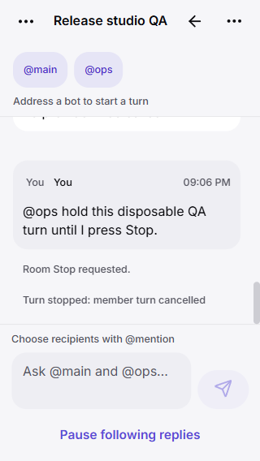
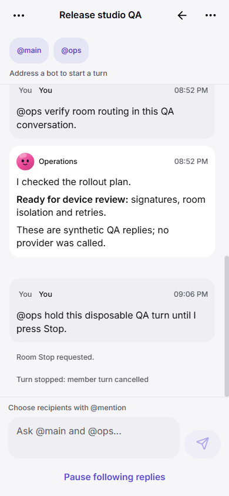
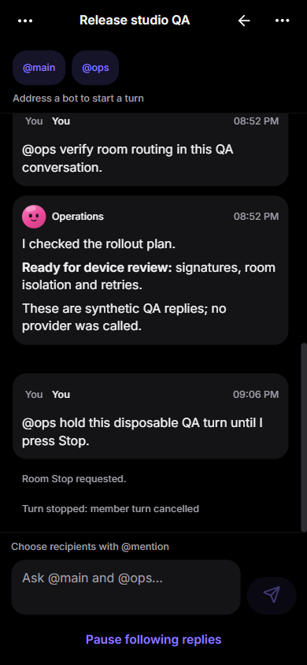
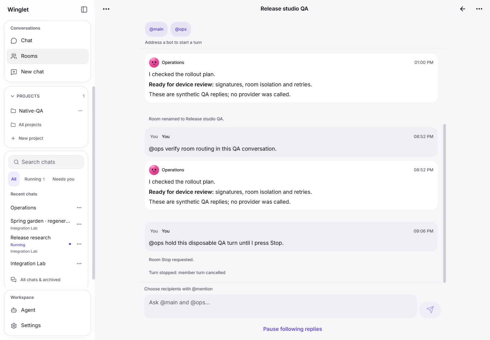
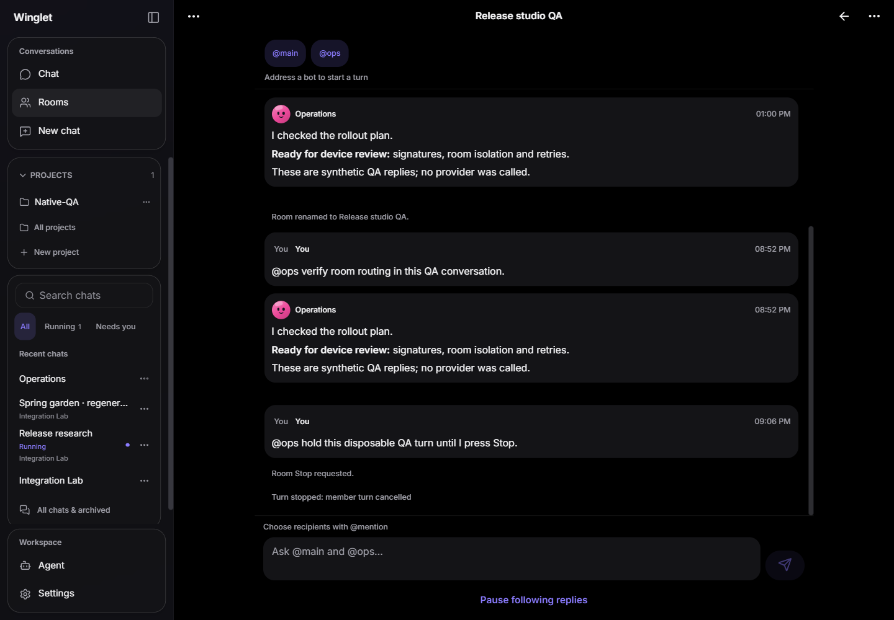

# Rooms: implementation and validation

Base: reviewed integration 4ef6c6e390ba1af06aa90ccb2322f92f8351a12b.
Primary architecture role: Software Architect, following the Agency Agents
architecture -> implementation -> distinct review workflow.

## UI plan

Rooms opens from navigation for the paired gateway. A room list shows title,
participants, unread state and active/archived state. The room screen has one
shared transcript with clear human/bot identities, a compact participant panel,
mention completion, an addressed composer, explicit running/waiting/error state
and a signed room Stop. Manage title, bot roster, archive and member read grants
in one bounded sheet. Narrow phones stack transcript and composer; wide screens
cap readable line length. Reuse Winglet theme, Sheet, pet/avatar and UI tokens.
Offline/unsupported/permission-revoked states disable controls without discarding
typed text. Room controls/sends never enter the private-chat offline outbox.

## Backend contract

Feature-local plugin/rooms*.py and app/src/features/rooms/. Minimal wiring in
hub.py, adapter.py and AppNavigation. Capabilities rooms/room_mentions only when
a real local worker exists. rooms_member_write=false: pinned Hermes hosted-room
turns do not propagate Winglet's member identity/tool limits. Members require an
explicit room read grant; they cannot submit/approve/retry or Stop as an owner.
This limitation must be visible, never an implicit privilege escalation.

Use the real pinned Hermes HostedRoomService/HostedRoomRuntime, own feature DB
and worker lifecycle, hidden bot_room sessions and the canonical profile turn
locks. Never adopt a private session merely because its title matches Group:.
Local served bots only; no peer links/remote gateway routes. Owner-signed writes
preserve actor/audit identity, expected revisions and durable retry receipts.
Only explicit mentions/selected recipients start turns; unaddressed text must
not trigger the upstream default broadcast. Hermes bounds rounds/messages and
uses durable task leases, task-specific cancellation and exact approval IDs.

GET /api/rooms, /api/rooms/{id}, /api/rooms/{id}/log are scoped reads.
POST /api/rooms creates; signed POST /api/rooms/{id}/{action} handles update,
send, seen, stop, retry and approve (seen is paired/signed; all other writes
owner-signed). Log cursors are room-local and epoch-local, not a global replay
protocol. No arbitrary RPC passthrough, profiles, task or session IDs accepted
without verifying room membership and current pending action coordinates.

Feature-specific additive metadata in rooms-meta.sqlite; real upstream room
state in rooms-runtime.sqlite beside it. Immutable upstream rosters change only
after authoritative Stop acknowledgement: allocate a successor epoch, preserve
old transcript and show the membership boundary. Avoid rewriting upstream
schema or forking the scheduler. Removing the plugin preserves both DBs.

## Reference and reuse

Read Herald snapshot95ca999 Rooms.kt, RoomsApi.kt, RoomMentions.kt, RoomTurns.kt
and RoomScreen.kt; actual Hermes pin4767698 hosted room service/driver/RPC and
discussion policy. The reference delegates rooms to groups.* and derives status
from typed events. Winglet uses its authenticated HTTP/signature protocol and
explicit gateway room ACL. No reference code copied or translated. The installed
Hermes implementation is called directly; its internals are not vendored here.

## Status

The owner room workflow is implemented. Member execution remains an explicit
upstream limitation, not a completed assignment06 acceptance criterion. Remote
peer rooms are unsupported. Existing paired members can read only rooms whose
owners explicitly grant access. No public release or new APK is part of this.

## Review fixes

- Preserve a stable shared local RPC object. Hermes uses transport identity to
  select conservative recovery and cancellation; per-task wrappers weaken it.
- Recheck the author during actual live observation, not just prepare_room.
  The live demotion regression confirms acknowledged Stop after owner loss.
- Resolve runtime aliases to durable session keys, check the requested profile
  home, then verify hidden bot_room identity in that profile's DB. Matching a
  private session's title never grants adoption permission.
- Permit rename, archive and reader removal when the unchanged roster includes
  an offline bot. Changed rosters still require served local bots.
- Keep drafts in the existing encrypted store, fence stale polls, clear revoked
  content, paginate by epoch, and cap loaded transcript events at1,000.

## Verification, 24 October 2026

- Lightweight Windows Python3.12 plugin suite: 413 passed, 23 skipped.
- Full installed pinned-Hermes Python3.14 Windows suite: 459 passed, one skipped,
  one unrelated profile-create failure (WinError5 renaming a temporary profile
  directory). That exact profile test passed separately. This combined run was
  not green; Linux Hermes CI remains the final merge gate.
- Final Rooms/HTTP tests plus real Hermes teamwork regression: 17 passed.
  Nine Rooms tests exercise real policy/runtime, grants/revocation, stale and
  unaddressed input, durable receipts, live demotion, Stop and epoch history.
  Actual session.create/list/resume/prompt.submit run in disposable stores;
  only agent construction/execution uses a non-network boundary. Two turns per
  default/named bot reuse separate hidden sessions and never cross stores.
  Completion uses Hermes's real pending-title hook.
- App: 324 tests passed; TypeScript, web and Android exports passed. Android
  export checks bundling/bytecode, not native execution.
- Browser using a disposable gateway and actual Hermes room scheduler: signed
  rename, addressed Operations-only reply, Stop confirmation and acknowledged
  cancellation (one cancelled task, no active fixture turns), and draft
  persistence after reload. No real model provider or personal chat was used.
- Inspected 320x568 and390x844 light,390x844 dark/reduced-motion, and1440x1000
  light/dark. No horizontal document overflow at320px; composer and Stop sheet
  remain reachable. Screenshots below contain disposable QA data.
- The phone used for01-05 became unavailable to ADB during06. No Rooms native
  runtime, Android keyboard/lifecycle, TalkBack, large-font or live-provider
  approval evidence is claimed. These remain device follow-up.

The checkpoint fixture disables optional Git bootstrapping inside its fake home
while exercising real snapshots with installed Git. A teamwork assertion uses
Path parts instead of POSIX separators. Neither changes production settings.

## Reproduce the disposable UI fixture

With the pinned Hermes editable install and plugin dependencies, build app/dist
then run `python scripts/native_feature_fixture.py`. It creates a fresh temp
workspace, synthetic pairing/replies, process/checkpoint examples, and rooms.
Pair using its printed QA URL. API9380 and test-only controls9381 bind only to
127.0.0.1. No live gateway files or providers are changed.

`/qa/room-hold` makes subsequent synthetic turns wait90 seconds for UI Stop;
`/qa/room-release` restores normal delay. `/qa/room-state` reports fixture
cancellation/call counts. These routes exist only in the standalone fixture,
never in the production plugin. Stop the process afterward.

Metadata/runtime DBs are additive and retained across restart/removal. Rollback
can stop loading this feature without deleting them. Upstream leases/recovery
decide in-flight outcomes; no automatic resend after ambiguous execution is
introduced. Retain mutation receipts rather than making old requests executable
again (100,000 cap); rooms/roster epochs also have explicit bounds (128/32).

