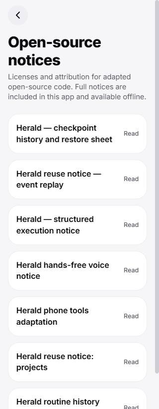
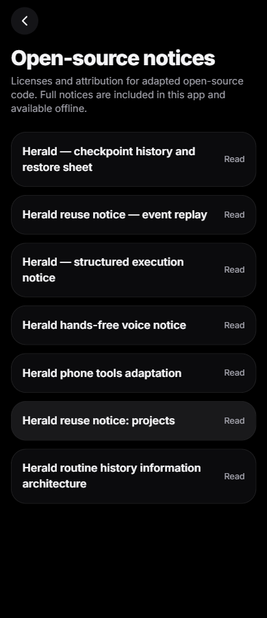
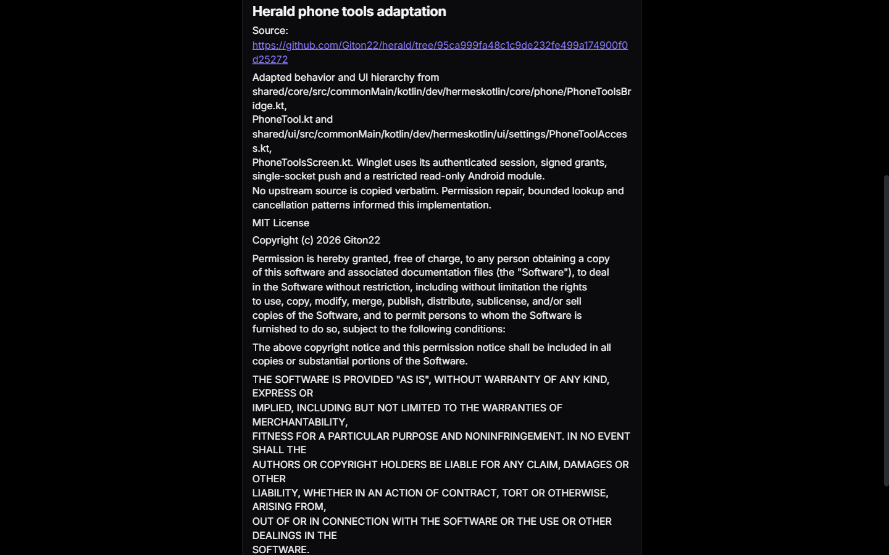

# Shipped third-party notices

Status: implemented; draft for orchestrator review. No APK build or device access in this follow-up.
Branch: codex/package-third-party-notices. PR: https://github.com/VIKASRP24/winglet/pull/56.
Approved integration c2d2ccdc7f8cba6a73617322a79538a8802d6153 is included.
The reused 09 worktree's preexisting untracked .venv09/ is preserved. The 11 private SDK/cache was not changed.

## Distribution contract

Source of truth: third_party/notices/*.md. All seven approved adaptation notices are included, including
herald-routine-history.md. Copyright, complete license terms and provenance are preserved verbatim as text;
only CRLF/LF is canonicalized to LF. Scoped .gitattributes makes generated copies stable across platforms.

The deterministic stdlib-only generator writes two committed copies:

- app/src/generated/third-party-notices.json: imported by the actual app route, so the full text ships
  inside the app's JavaScript/Android bytecode bundle. Reading a notice requires no network request.
- plugin/THIRD_PARTY_NOTICES.md: inside the existing release's copied plugin directory, so the full
  notices accompany the distributed plugin. No release workflow or packaging exclusion was changed.

From the repository root:

    python scripts/generate_third_party_notices.py
    python scripts/generate_third_party_notices.py --check

Generation sorts filenames, reads UTF-8, retains complete source text, and atomically replaces changed
outputs. Empty/missing source sets fail rather than erasing packaged notices. Check mode returns nonzero
for changed/added/deleted sources or stale/missing outputs and never rewrites a file.

scripts/build-web.sh regenerates before exporting. The normal pytest suite includes the generator check,
so CI rejects stale copies without workflow changes. After merging any future notice addition or edit,
rerun the generator and commit both outputs before building the combined app/plugin. This also applies
if the native voice follow-up updates its existing attribution.

## Accessible offline UI

About → Open-source notices uses the existing Screen, Card, Tap and selectable Markdown components.
Each notice has an independently expandable control with its full title, Read/Hide text, native expansion
state and an explicit web aria-expanded alias. Existing themes, motion preferences, navigation and pets
are preserved. No dependencies, permissions, version, model/provider or release-workflow changes.

## Actual checks and limits

- Eight focused pytest checks passed after the seven-notice integration: full Unicode/copyright/license/
  provenance preservation, stable order, independent comparison of every repository source against both
  packaged copies, and stale-copy rejection without writes.
- TypeScript passed, including the final explicit web accessibility prop.
- One-worker production web export passed (1860 modules; 9.6s Metro bundle). No generated plugin/web changed.
- Actual exported About navigation displayed all seven notices. Networking was disabled before expanding
  the phone-tools notice; its copyright, complete permission/warranty terms and provenance rendered.
- Actual 320/390/820/1440 widths had no document or text overflow. Light/dark/reduced-motion inspected;
  keyboard Space toggled a notice. Browser console: 0 errors/0 warnings in the inspected application flow.
- UI review found that this React Native Web version ignores native accessibilityState.expanded. The final
  explicit aria-expanded prop was typechecked and verified for false/true using the actual installed RNW
  server renderer. No further heavy export ran while the root combined APK build occupied the slot;
  final PR CI separately exports that exact source.

The exported layout/data source was frozen at 2886792; 50b4374 adds only the explicit web expansion-state
alias. Screenshots show the actual exported application, without native/API mocks or paired servers.
They establish browser layout/offline reading, not physical Android TalkBack/font-size behavior. Root
owns combined APK validation. No phone, ADB, emulator, APK build or personal data access occurred here.

The isolated browser and verified local preview server 8326 were closed after checks. An OS application
control policy blocked the Python preview launch; the existing Node runtime served the same export.

## Review and rollback

Review generator/render, the --check tests, app JSON import, About navigation, then plugin output. No source
license file is edited or replaced by this feature. Reverting these feature commits removes the packaged
copies/UI/hook; attribution source files remain. Do not distribute adapted code without its notices.
